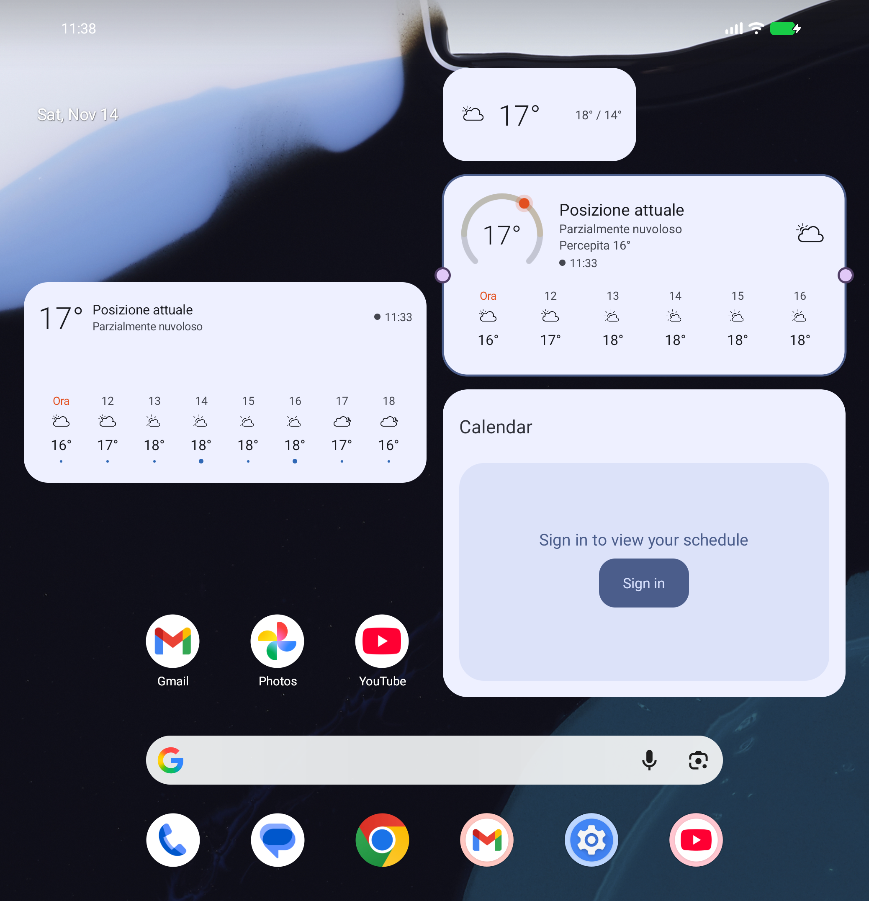

# Ameki

**あめき · 雨木**: an open source Android weather app where the widgets are the main product.

Ameki brings Pixel-quality weather widgets to any Android phone. It was designed first for Samsung foldables, whose One UI ships only a thin At a Glance summary. It has five responsive Material You widgets, a calm main screen built around a temperature dial, and a three-step setup. There is nothing to configure.

<p align="center">
  
  
</p>
<p align="center"></p>

## Features

- **Five widgets**: Compact, Hourly, Daily, Complete and Rain (the next two hours in 15-minute steps). Each one shows more as you make it bigger, and you can set the place, style (wallpaper colours, dark, transparent) and background opacity per widget.
- **Widgets read only from the local cache.** A single background job refreshes everything, at an interval you choose (15–180 minutes). Offline, you see the last data along with the time it was fetched.
- **Main screen**: now, 24 hours with rain probability, 10 days with range bars, precipitation, wind and humidity charts, wind, humidity, UV, pressure, visibility, sun and moon.
- **Built for foldables**: a single column on the cover screen, and places beside the forecast on the inner screen.
- Italian and English, light and dark themes, dynamic colour, TalkBack labels.

## Data sources

| Source | In public builds | Notes |
| --- | --- | --- |
| [Open-Meteo](https://open-meteo.com) | Yes, the default | Free for non-commercial use, no key. Data under [CC BY 4.0](https://creativecommons.org/licenses/by/4.0/). Place search uses Open-Meteo geocoding (GeoNames). |
| [Google Weather API](https://developers.google.com/maps/documentation/weather) | No | Off in public builds, see below. |

### Google Weather API (personal builds only)

Ameki includes a complete Google Weather API source: hourly pagination, public alerts, Google's caching limits and a key check. It is **turned off in public builds** because section 21.1 of the Google Maps Platform Service Specific Terms forbids using Weather API content in a weather app. See [ADR 0002](docs/adr/0002-google-source-off-in-public-builds.md).

To build it for your own use, with your own key, at your own responsibility under Google's terms:

```bash
./gradlew assembleRelease -Pameki.googleSource=true
```

The app then offers a choice of source and walks you through creating, restricting and checking a key. The key is stored encrypted with the Android Keystore and is sent only as a request header.

## Privacy

There are no accounts, analytics or trackers, and the app does not depend on Google Play Services. Approximate location is enough. It stays on the phone and is sent, rounded to about 1 km, only to the weather source. Background location is optional and only used so widgets can follow you when you travel.

## Building

Requirements: JDK 21 and the Android SDK (compileSdk 37).

```bash
./gradlew assembleDebug      # app/build/outputs/apk/debug/
./gradlew test               # unit tests, repository tests, Roborazzi screenshots
./gradlew lintDebug
```

### Project layout

```
app                 entry point, navigation, DI
core/model          domain model, units, refresh and caching policy (pure Kotlin)
core/data           Room cache, settings, refresh worker, repositories
core/ui             theme, Meteocons icons, temperature dial and shared components
source/api          the WeatherSource interface
source/openmeteo    Open-Meteo
source/google       Google Weather API (behind the build flag)
feature/*           onboarding, home, places, settings
widget              Glance widgets and their configuration
```

To add a data source, write a module that implements `WeatherSource` and register it in `SourceRegistry`. The UI hides whatever the source does not support.

Decisions and vocabulary are recorded in [docs/adr](docs/adr) and [GLOSSARY.md](GLOSSARY.md).

## Credits

- Weather icons and animations: [Meteocons](https://github.com/basmilius/meteocons) by Bas Milius (MIT).
- Typeface: [Hanken Grotesk](https://github.com/marcologous/hanken-grotesk) (OFL).

See [THIRD_PARTY_NOTICES.md](THIRD_PARTY_NOTICES.md).

## Licence

[GPL-3.0](LICENSE)
