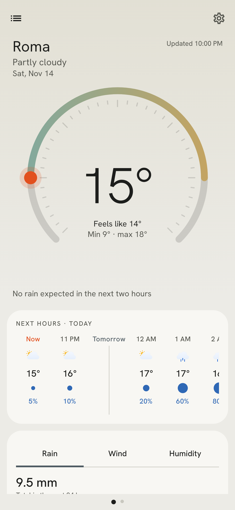
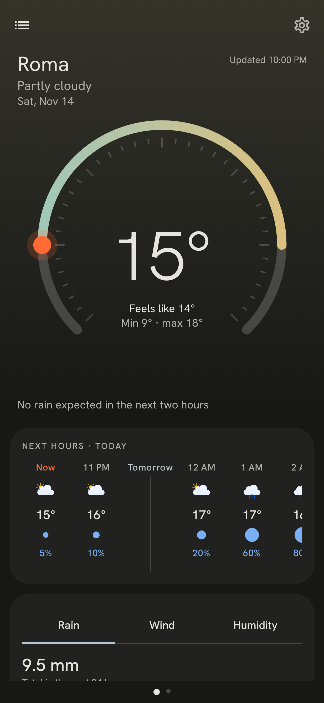
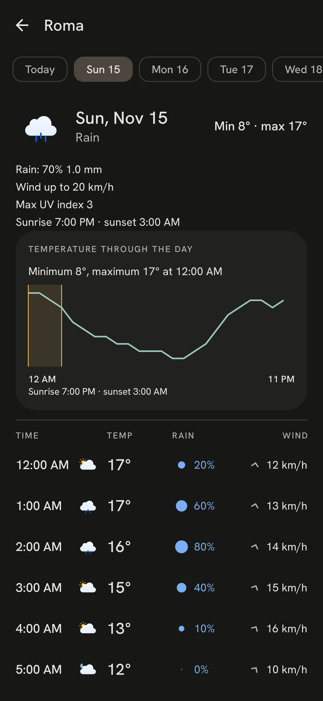
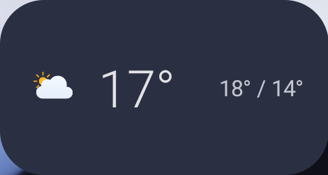

<div align="center">

# Ameki

あめき · 雨木

Weather for your home screen.

[](https://github.com/antomanc/ameki/actions/workflows/ci.yml)
[](#installation)
[](LICENSE)

[Features](#features) · [Widgets](#widgets) · [Build](#building) · [Contribute](#contributing)

</div>

Ameki is an open source Android weather app built around home-screen widgets. Check the temperature and the next few hours without opening the app. Open it for a ten-day forecast, a closer look at a day, or another place.

Forecasts come from Open-Meteo, with no account or API key required. The codebase also includes an optional Google Weather API source, giving local builds access to Google's forecasts, now powered in part by WeatherNext 3. See [Google Weather and WeatherNext 3](#google-weather-and-weathernext-3) for availability and build instructions.

The app uses Material You colours and adapts to phones, tablets and foldable screens.

<p align="center">
  
  
  
</p>

## Features

- Current conditions with a temperature dial, feels-like temperature and daily highs and lows.
- An hourly forecast with rain probability, a ten-day outlook and day pages you can swipe between.
- Precipitation, wind and humidity charts, plus UV, pressure, visibility, sunrise, sunset and moon phase when available.
- Saved places and optional current location. Wider screens show the place list beside the forecast.
- Light and dark themes, wallpaper colours, configurable units and 12/24-hour time.
- English and Italian for the app and widgets, following the system language. Android 13 and later also expose the app language in system settings.
- TalkBack labels, with no ads, analytics or account registration.

## Widgets

Each widget adapts to its size. Choose a place, wallpaper colours, a dark or transparent background, and background opacity for each instance.

| Widget | What it shows |
| --- | --- |
| Compact | Current temperature, condition and daily range |
| Hourly | Current weather and the hours ahead |
| Daily | Upcoming days with temperature ranges |
| Complete | Current weather with hourly and daily forecasts |
| Rain | Precipitation for the next two hours in 15-minute steps, where available |

<p align="center"></p>

Widgets read from a shared local cache. One network WorkManager job refreshes the data for the app and widgets, with a default interval of 30 minutes. Open-Meteo builds let you choose from 15 to 180 minutes. A separate local job updates cache-expiry labels without requiring a connection. Android may defer background work to save battery.

Offline, cached forecasts remain available with their update time, within the source's retention limits. Rain coverage and other forecast details depend on the data source and location.

## Installation

Ameki requires Android 12 (API 31) or later. Download the signed APK from [GitHub Releases](https://github.com/antomanc/ameki/releases/latest), or build from source using the instructions below. GitHub also provides the source archive for each release. F-Droid distribution is planned, and the app does not require Google Play Services.

On first launch, search for a city or allow approximate location. Add widgets through your launcher's widget picker and configure each one for the place you want to follow.

## Data sources

| Source | Default builds | Notes |
| --- | --- | --- |
| [Open-Meteo](https://open-meteo.com) | Enabled | No API key. The free API is for non-commercial use. Weather data is under [CC BY 4.0](https://creativecommons.org/licenses/by/4.0/); place search uses Open-Meteo geocoding (GeoNames). |
| [Google Weather API](https://developers.google.com/maps/documentation/weather) | Disabled | Available behind a build flag; see below. |

Open-Meteo's [terms and privacy policy](https://open-meteo.com/en/terms) apply to API requests. Default builds do not provide official weather alerts.

### Google Weather and WeatherNext 3

Ameki integrates the Google Maps Platform Weather API. Google [announced WeatherNext 3 integration into this API](https://blog.google/innovation-and-ai/models-and-research/google-deepmind/introducing-weathernext-3/) in September 2026. The API combines forecasting systems; Ameki uses the processed forecasts it returns and does not run WeatherNext 3 on your phone or select a model version.

The Google source includes hourly pagination, public alerts, cache retention rules and an API key check. It is turned off in default builds because of the Weather API usage restrictions in section 21.1 of the [Google Maps Platform Service Specific Terms](https://cloud.google.com/maps-platform/terms/maps-service-terms). See [ADR 0002](docs/adr/0002-google-source-off-in-public-builds.md) for the project's decision.

The flag below enables the source for local experimentation. Enabling it does not grant permission to use or redistribute Google's data; review the terms that apply to your billing region and use case.

```bash
./gradlew assembleRelease -Pameki.googleSource=true
```

The app then offers a choice of source and walks you through creating, restricting and checking your own key. The key is stored encrypted with the Android Keystore and is sent only as a request header.

## Privacy

Ameki has no accounts, analytics or trackers. Preferences, saved places and cached forecasts are stored on the device.

- Weather requests go directly to the selected source with coordinates rounded to about 1 km. The source also receives the connection's IP address.
- City searches are sent to Open-Meteo's geocoding service.
- With location permission, Android supplies the device position. Ameki can use Android's geocoder to look up a place name; the geocoder implementation may contact a service provided by the device vendor.
- Location permission is optional: you can search for a city instead. Background location is requested separately so widgets can follow you when you travel.

Weather and geocoding services handle requests under their own privacy policies. Open-Meteo describes its request logging in its [privacy policy](https://open-meteo.com/en/terms#privacy).

## Building

Requirements: JDK 21 and the Android SDK (compileSdk 37). Use the checked-in Gradle wrapper. Set `ANDROID_HOME` to your SDK directory, or set `sdk.dir` in an untracked `local.properties` file.

```bash
git clone https://github.com/antomanc/ameki.git
cd ameki
./gradlew assembleDebug      # app/build/outputs/apk/debug/
./gradlew test               # unit tests, repository tests, Roborazzi screenshots
./gradlew lintDebug
```

Debug builds use a separate application ID, `dev.antomanc.ameki.debug`, so they can coexist with release builds.

### Release signing

```bash
./gradlew assembleRelease
```

Release APKs are written to `app/build/outputs/apk/release/`. Without signing credentials, a local release build falls back to the debug key. For distribution, supply these environment variables:

| Variable | Value |
| --- | --- |
| `AMEKI_KEYSTORE` | Absolute path to the signing keystore |
| `AMEKI_KEYSTORE_PASSWORD` | Keystore password |
| `AMEKI_KEY_ALIAS` | Signing key alias |
| `AMEKI_KEY_PASSWORD` | Signing key password |

Keep the signing key safe and use the same key for future updates. Keystores and local configuration are excluded from Git. CI runs tests, lint and both APK builds, then uploads build artifacts; it does not publish signed releases automatically.

### Project layout

```text
app                 entry point, navigation, DI
core/model          domain model, units, refresh and caching policy (pure Kotlin)
core/data           Room cache, settings, refresh worker, repositories
core/ui             theme, Meteocons icons, temperature dial and shared components
source/api          the WeatherSource interface
source/openmeteo    Open-Meteo
source/google       Google Weather API (behind the build flag)
feature/*           onboarding, home, places, settings
widget              Glance widgets and their configuration
```

To add a data source, write a module that implements `WeatherSource` and register it in `SourceRegistry`. The UI hides sections the source does not support.

Product scope is in [PRODUCT.md](PRODUCT.md). Decisions and vocabulary are recorded in [docs/adr](docs/adr) and [GLOSSARY.md](GLOSSARY.md).

## Contributing

[Report a bug or suggest a feature](https://github.com/antomanc/ameki/issues). For bugs, include your Android version, device and launcher, the steps to reproduce the issue and the app version. Remove API keys, precise locations and other personal information from logs and screenshots.

For a substantial change, open an issue first to discuss scope. Keep pull requests focused and run the build, tests and lint commands above. UI changes should include screenshots and a check on a running device or emulator. Widget changes should cover more than one size.

Translations live in each module's `res/values/strings.xml` (English) and `res/values-it/strings.xml` (Italian).

## Credits

- Weather icons and animations: [Meteocons](https://github.com/basmilius/meteocons) by Bas Milius (MIT).
- Typeface: [Hanken Grotesk](https://github.com/marcologous/hanken-grotesk) (OFL).

See [THIRD_PARTY_NOTICES.md](THIRD_PARTY_NOTICES.md).

## Licence

Ameki is licensed under [GPL-3.0](LICENSE). Weather data, fonts and icons retain their respective licences.
